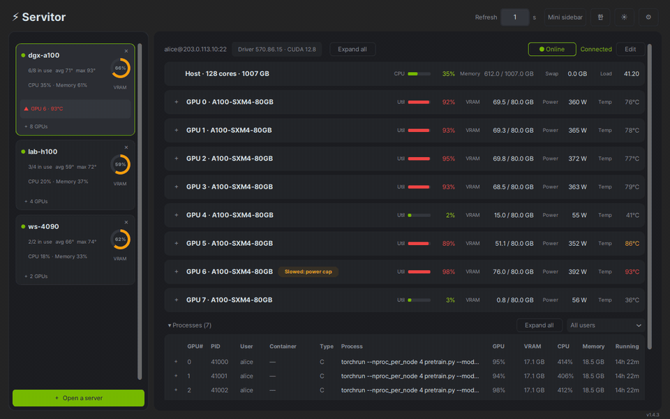

# Servitor

*[한국어 문서](docs/README.ko.md)*

Watch the NVIDIA GPUs on all your servers from one window on your desktop.



## Features

- **Every server at a glance** — usage, VRAM, temperature and power for each
  GPU, plus the server's own CPU and memory.
- **Who is using the GPU** — every process with its user, command line, GPU and
  CPU use, memory and running time.
- **Tells you when something is wrong** — a GPU that disappears, runs hot, slows
  down, or stops answering is flagged, and can light up the taskbar and tray.
- **Keeps watching in the background** — close it to the system tray or to a
  small always-on-top sidebar.
- **Nothing to install on the servers** — only SSH and the NVIDIA driver.
- English and Korean, dark and light themes.

## Install

Download the latest files from the **[Releases](../../releases)** page.

**Windows** — run `Servitor-Setup-<version>.exe`. It is not code-signed, so the
first time Windows shows "Windows protected your PC": choose **More info ›
Run anyway**. Requires 64-bit Windows 10 or newer.

**Linux** — download `Servitor-<version>-x86_64.AppImage`, then install it:

```bash
chmod +x Servitor-*-x86_64.AppImage
./Servitor-*-x86_64.AppImage --install
```

Start it from your applications menu, or with `servitor` in a terminal. The
downloaded file can be deleted afterwards.

Works on Ubuntu 22.04 and newer, and other distributions of the same age.

**Tested on** Ubuntu 24.04 LTS (GNOME 46, X11 session) and Windows 11.

## Usage

1. Click **＋ Open a server**, then **＋ Add a new server**.
2. Enter the server's address, your username and password. **Test connection**
   checks it before you save.
3. Click **Open**. The server appears in the sidebar and stays there the next
   time you start Servitor.

"This computer" is always available too, with no SSH needed.

## Server requirements

A Linux server with the NVIDIA driver installed (so `nvidia-smi` works) and an
SSH account. Servers are assumed to run Linux. Nothing is installed on them and
no administrator rights are needed.

**How it works** — Servitor logs in over SSH and runs `nvidia-smi`, the
monitoring tool that comes with the NVIDIA driver, reading its output as it
streams. It also reads the server's CPU and memory from `/proc`, which can be
turned off in Settings. It only reads; nothing is changed or left on the server.
"This computer" works the same way, locally.

## Passwords and security

Saved passwords are stored **in plain text** in your user's settings file,
readable only by your account. If you would rather not:

- tick **Don't save it; ask when connecting** — Servitor asks when you go online
  and forgets it when it quits, or
- use SSH keys — leave the password empty and the keys in `~/.ssh` are used
  automatically.

Servitor remembers each server's host key the first time it connects, in
`known_hosts` beside the settings file, and refuses to connect if the key later
changes. If you reinstalled the server, press **● Offline** and choose **Trust
new key**.

## Uninstall

**Windows** — uninstall from **Control Panel › Programs and Features** (or
**Settings › Apps › Installed apps**). It asks whether to delete your saved
servers and passwords as well.

**Linux** — `servitor --remove` removes the program and keeps your settings;
`servitor --remove --purge` also deletes saved servers, passwords and the fonts
Servitor copied. Settings are kept in `~/.config/servitor/`
(`%APPDATA%\servitor\` on Windows).

## Commands run on the server

Everything Servitor does on a server goes through these, all read-only:

- `nvidia-smi --query-gpu=… -lms` — GPU utilization, VRAM, temperature, power and health
- `nvidia-smi pmon` (or `--query-compute-apps`) — the processes using each GPU
- `nvidia-smi`, `nvidia-smi -L` — driver and CUDA versions, the GPU list
- `/proc` files, `ps`, `stat`, `nproc`, `getconf` — CPU, memory, and each
  process's owner, command line, container and running time
- `ls /proc/driver/nvidia/gpus`, `lspci` — only when no GPU shows up, to say why
