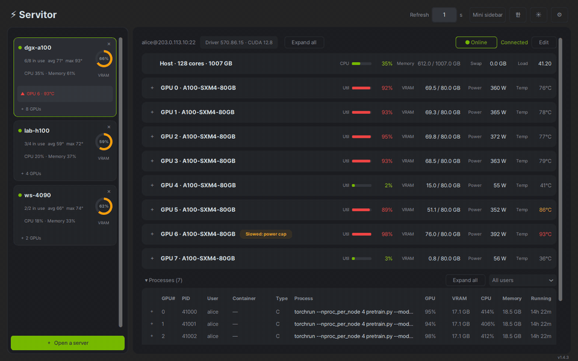

# Servitor

*[English README](../README.md)*

여러 서버의 NVIDIA GPU를 내 컴퓨터의 창 하나에서 지켜봅니다.



## 기능

- **모든 서버를 한눈에** — GPU마다 사용률, VRAM, 온도, 전력을 보여 주고, 서버 자체의
  CPU와 메모리도 함께 보여 줍니다.
- **누가 GPU를 쓰는지** — 프로세스마다 사용자, 명령줄, GPU·CPU 사용률, 메모리, 실행
  시간을 보여 줍니다.
- **이상이 생기면 알려 줍니다** — GPU가 사라지거나, 과열되거나, 느려지거나, 응답이
  없으면 표시하고, 작업표시줄과 트레이 아이콘 색으로도 알려 줄 수 있습니다.
- **창을 닫아도 계속 지켜봅니다** — 시스템 트레이나, 항상 위에 떠 있는 작은 사이드바로
  보낼 수 있습니다.
- **서버에는 설치할 것이 없습니다** — SSH와 NVIDIA 드라이버만 있으면 됩니다.
- 한국어·영어, 다크·라이트 테마.

## 설치

**[Releases](../../../releases)** 페이지에서 최신 파일을 내려받으세요.

**윈도우** — `Servitor-Setup-<버전>.exe`를 실행합니다. 코드 서명이 없어서 처음 실행할
때 "Windows의 PC 보호" 창이 뜹니다. **추가 정보 › 실행**을 누르면 됩니다. 64비트
윈도우 10 이상에서 동작합니다.

**리눅스** — `Servitor-<버전>-x86_64.AppImage`를 내려받아 설치합니다:

```bash
chmod +x Servitor-*-x86_64.AppImage
./Servitor-*-x86_64.AppImage --install
```

앱 메뉴에서 실행하거나, 터미널에서 `servitor`로 실행합니다. 내려받은 파일은 이제
지워도 됩니다.

우분투 22.04 이상, 또는 그 무렵 이후의 다른 배포판에서 동작합니다.

**테스트한 환경:** 우분투 24.04 LTS(GNOME 46, X11 세션), 윈도우 11.

## 사용법

처음에는 영어로 시작합니다. 오른쪽 위 **한** 버튼을 누르면 한국어로 바뀝니다.

1. **＋ 서버 열기**를 누르고, **＋ 새 서버 추가**를 누릅니다.
2. 서버 주소, 사용자 이름, 비밀번호를 넣습니다. 저장하기 전에 **연결 테스트**로
   확인할 수 있습니다.
3. **열기**를 누르면 서버가 사이드바에 나타나고, 다음에 켤 때도 그대로 있습니다.

"이 컴퓨터"도 항상 볼 수 있습니다. SSH가 필요 없습니다.

## 서버 요구 사항

NVIDIA 드라이버가 설치된 리눅스 서버(`nvidia-smi`가 실행되면 됨)와 SSH 계정만
있으면 됩니다. 서버는 리눅스라고 가정합니다. 서버에 설치하는 것은 없고 관리자 권한도
필요 없습니다.

**작동 방식** — Servitor는 SSH로 접속해 NVIDIA 드라이버에 함께 들어 있는 모니터링 도구
`nvidia-smi`를 실행하고, 그 출력을 계속 받아 읽습니다. 서버의 CPU와 메모리는 `/proc`에서
읽으며, 이건 설정에서 끌 수 있습니다. 읽기만 하고, 서버에 바꾸거나 남기는 것은 없습니다.
"이 컴퓨터"도 같은 방식으로, 내 컴퓨터에서 직접 동작합니다.

## 비밀번호와 보안

저장한 비밀번호는 사용자 설정 파일에 **암호화 없이** 저장됩니다. 파일은 내 계정만 읽을
수 있습니다. 저장하고 싶지 않다면:

- **저장하지 않고 접속할 때마다 묻기**를 켜세요. 온라인으로 바꿀 때 묻고, 프로그램을
  끄면 잊습니다.
- 또는 SSH 키를 쓰세요. 비밀번호를 비워 두면 `~/.ssh`의 키를 자동으로 씁니다.

Servitor는 서버에 처음 접속할 때 그 서버의 호스트 키를 설정 파일 옆 `known_hosts`에
기억해 두고, 나중에 키가 바뀌면 접속하지 않습니다. 서버를 다시 설치한 것이라면
**● 오프라인**을 누르고 **새 키로 접속**을 고르세요.

## 삭제

**윈도우** — **제어판 › 프로그램 추가/제거**(또는 **설정 › 앱 › 설치된 앱**)에서 삭제합니다.
저장한 서버와 비밀번호도 지울지 묻습니다.

**리눅스** — `servitor --remove`는 프로그램을 지우고 설정은 남깁니다.
`servitor --remove --purge`는 저장한 서버, 비밀번호, Servitor가 복사한 글꼴까지 지웁니다.
설정은 `~/.config/servitor/`(윈도우는 `%APPDATA%\servitor\`)에 있습니다.

## 서버에서 실행하는 명령

Servitor가 서버에서 하는 일은 아래가 전부이고, 모두 읽기만 합니다.

- `nvidia-smi --query-gpu=… -lms` — GPU 사용률, VRAM, 온도, 전력, 하드웨어 상태
- `nvidia-smi pmon` (또는 `--query-compute-apps`) — GPU를 쓰는 프로세스
- `nvidia-smi`, `nvidia-smi -L` — 드라이버와 CUDA 버전, GPU 목록
- `/proc` 파일, `ps`, `stat`, `nproc`, `getconf` — CPU, 메모리, 그리고 프로세스별
  소유자, 명령줄, 컨테이너, 실행 시간
- `ls /proc/driver/nvidia/gpus`, `lspci` — GPU가 안 보일 때만, 이유를 알아내려고
